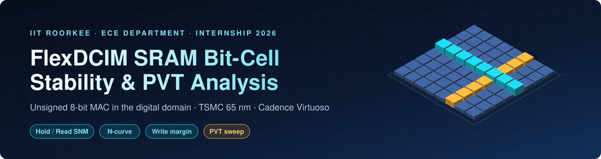
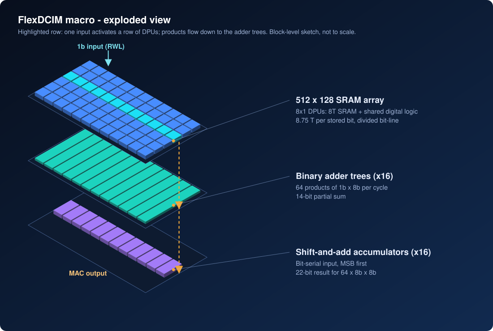
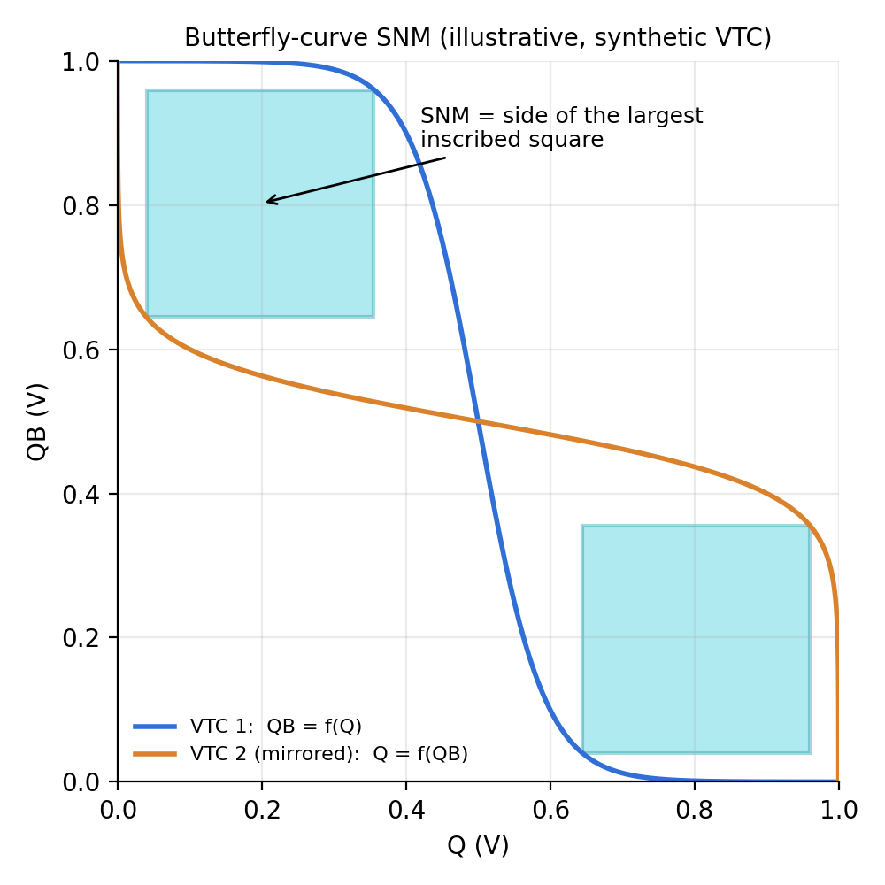
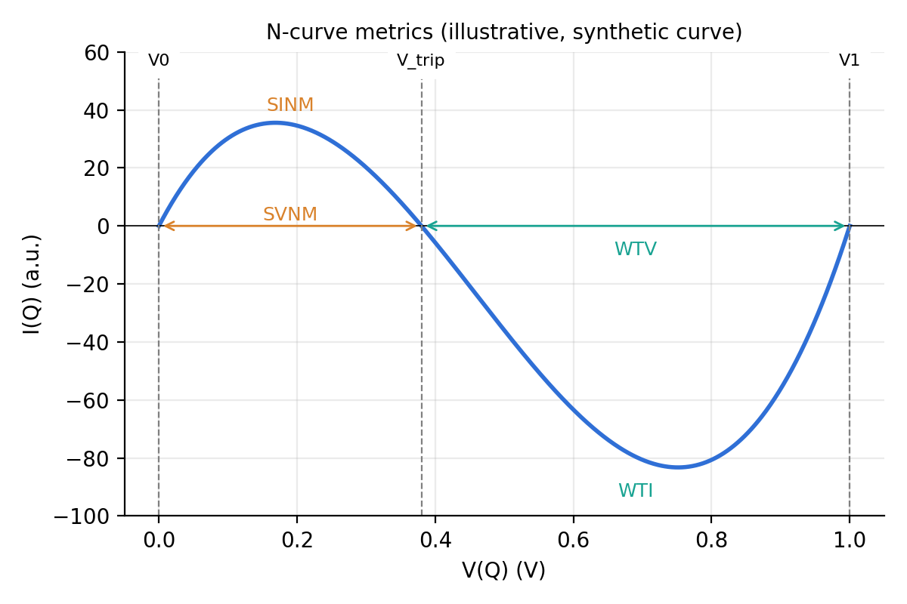
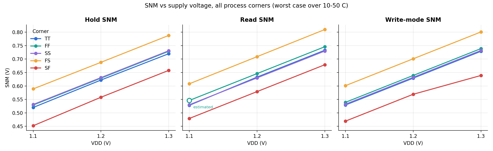
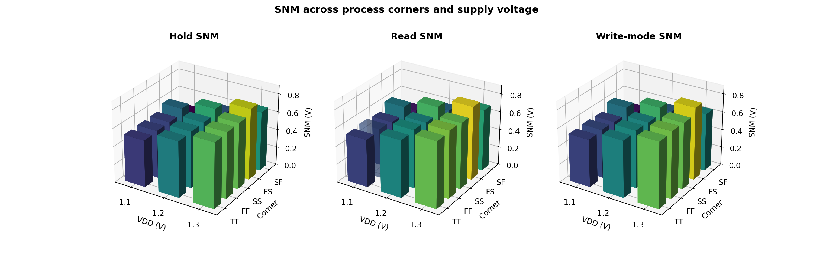

<div align="center">



<br/>


**Internship Project: Unsigned 8-bit MAC Operation using 6T SRAM in Digital Domain**
Dept. of Electronics & Communication Engineering, IIT Roorkee | Supervisor: Prof. Sudeb Dasgupta | 15 Jun - 31 Jul 2026

[Overview](#overview) | [Architecture](#architecture) | [Analyses](#analyses-performed) | [Results](#key-results) | [Tools](#tools--tech-stack) | [Structure](#repository-structure) | [Getting started](#getting-started)

</div>

---

## Overview

This project was carried out during a research internship at **IIT Roorkee**. It studies the SRAM bit-cell used in
**FlexDCIM**, a fully digital compute-in-memory (CIM) macro, and verifies that the cell is stable and reliable enough
to perform **unsigned 8-bit multiply-accumulate (MAC)** operations directly inside the memory array.

The work covers a single FlexDCIM-style DPU bit-cell (the "UNO DPU" schematic) in **Cadence Virtuoso on the TSMC 65 nm node**: transient
verification of its multiply behaviour, **butterfly-curve SNM for hold, read and write-mode operation**, and a **PVT sweep** over five process corners,
three supply voltages and five temperatures (75 simulations per mode). Python tooling in this repo post-processes the data, includes N-curve extraction,
and provides a bit-accurate model of the unsigned 8-bit MAC pipeline.

### Why it matters
Moving data between memory and processor dominates energy in AI edge hardware. Computing inside the SRAM avoids that
cost, but only if every cell holds, reads and writes correctly under real-world variation. This project quantifies
that robustness.

## Objectives

- Build the FlexDCIM digital bit-cell (6T latch + shared digital logic) in a 65 nm flow and verify its multiply behaviour in transient simulation.
- Measure **hold, read and write-mode SNM** with the butterfly-curve method.
- Evaluate robustness across **PVT**: TT, FF, SS, FS, SF corners; 1.1 / 1.2 / 1.3 V; 10-50 C.
- Provide N-curve extraction (SVNM, SINM, WTV, WTI) and a software reference of the unsigned 8-bit MAC.

## Architecture

<p align="center"></p>

| Block | Description |
|---|---|
| **8x1 DPU** | Eight 8T SRAM parts share one digital logic block: **8.75 T per stored bit**, divided bit-line for fast evaluation |
| **SRAM array** | 512 x 128 bits (64 Kb); one 1-bit input activates a row, producing 1b x 8b products |
| **Adder trees (x16)** | Sum 64 products per cycle into a 14-bit partial result |
| **Accumulators (x16)** | Bit-serial shift-and-add over input bits, 22-bit result for 64 x 8b x 8b |
| **Reconfigurable precision** | 1-8 bit weights through weight-select signals, bit-serial inputs |

## Analyses performed

| Analysis | Method | Purpose |
|---|---|---|
| **DPU transient** | Spectre transient, 0-100 ns, Q = 0 and Q = 1 | Verify the multiply path and CBL output |
| **Hold SNM** | Butterfly curve, WL low | Data retention in standby |
| **Read SNM** | Butterfly curve, WL high, bit-lines precharged | Robustness against read disturb |
| **Write-mode SNM** | Butterfly curve, WL high, bit-lines at retention levels | Half-select write-disturb margin |
| **PVT sweep** | 5 corners x 3 supplies x 5 temperatures | Variation across process, voltage and temperature |
| **N-curve** | `ncurve_metrics.py` (SVNM, SINM, WTV, WTI) | Current/voltage based read and write margins |
| **MAC model** | Python golden model | Reference values for the digital datapath |

### How the margins are measured

<table>
<tr>
<td align="center" width="50%"><br/><sub><b>Butterfly SNM</b>: side of the largest square inside a lobe</sub></td>
<td align="center" width="50%"><br/><sub><b>N-curve</b>: SVNM / SINM (read), WTV / WTI (write)</sub></td>
</tr>
</table>

> These two figures are **illustrations built from synthetic curves** to explain the measurement method
> (generated by `scripts/make_assets.py`). Simulation results are documented in [`docs/results.md`](docs/results.md).

## Key results

Worst-case SNM over 10-50 C (all corners, 1.1-1.3 V):

| Mode | SNM range | Worst case | Best case |
|---|---|---|---|
| Hold | 0.452 - 0.788 V | SF @ 1.1 V | FS @ 1.3 V |
| Read | 0.479 - 0.810 V | SF @ 1.1 V | FS @ 1.3 V |
| Write-mode | 0.469 - 0.801 V | SF @ 1.1 V | FS @ 1.3 V |

<p align="center"></p>
<p align="center"></p>

- All 45 corner / supply / mode conditions show positive margin: no data-loss or disturb risk across the swept space.
- SNM scales almost linearly with VDD (about +100 mV per +0.1 V); **SF** (slow NMOS, fast PMOS) is the critical corner in every mode, **FS** is best.
- Corner spread is dominated by N/P skew rather than overall speed (TT, FF and SS agree within about 10-18 mV).
- DPU transient: Q = 1 gives 6 CBL output pulses, Q = 0 gives 4 (with brief negative dips), under identical EN / RWL timing.
- Read-mode FF @ 1.1 V is a trend-interpolated estimate pending simulation.

Full tables, observations, the transient discussion, a note on SNM marker readings and open items: [`docs/results.md`](docs/results.md).

## Tools & tech stack

| Area | Tools |
|---|---|
| Circuit design and simulation | Cadence Virtuoso, Spectre, ADE Assembler / ADE XL |
| Technology | TSMC 65 nm CMOS |
| Automation | OCEAN / SKILL templates |
| Post-processing | Python (NumPy, pandas, Matplotlib) |
| Testing and CI | pytest, GitHub Actions |

## Repository structure

```
.
├── assets/            Banner and 3D architecture artwork
├── docs/
│   ├── background.md  Reference design and CIM background
│   ├── methodology.md Simulation setup for every analysis
│   ├── results.md     Results tables, observations, open items
│   └── images/
├── testbenches/       Spectre testbench templates (butterfly, N-curve)
├── scripts/
│   ├── python/        snm_summary, snm_butterfly, ncurve_metrics, pvt_plot, pvt_3d, mac8_golden
│   ├── ocean/         PVT sweep automation template
│   └── make_assets.py Regenerates README artwork
├── data/              snm_pvt_summary.csv (hold / read / write SNM per corner and VDD)
├── results/figures/   SNM vs VDD and 3D SNM plots
├── schematics/        Schematic screenshots
└── tests/             Unit tests (run in CI)
```

## Getting started

```bash
git clone <this-repo-url>
cd flexdcim-6t-sram-tsmc65-analysis
pip install -r requirements.txt
pytest -q                                  # run the unit tests
python scripts/python/mac8_golden.py       # unsigned 8-bit MAC model demo
python scripts/python/snm_summary.py data/snm_pvt_summary.csv --out results/figures   # regenerate result plots
```

Analysing further exported Virtuoso data (temperature-resolved or raw butterfly / N-curve sweeps):

```bash
# Butterfly SNM  (CSV columns: v, qb_of_q, q_of_qb; modes: hold | read | write | writeability)
python scripts/python/snm_butterfly.py data/read_butterfly.csv --mode read --plot results/figures/read_snm.png

# N-curve metrics (CSV columns: v, i)
python scripts/python/ncurve_metrics.py data/ncurve.csv --vdd 1.0 --plot results/figures/ncurve.png

# PVT summary (CSV columns: corner,temp_c,vdd,metric,value)
python scripts/python/pvt_plot.py data/pvt_summary.csv --out results/figures
python scripts/python/pvt_3d.py   data/pvt_summary.csv --metric read_snm --out results/figures
```

## Key learnings

- Static noise margin analysis (butterfly and N-curve) and what each margin says about cell robustness.
- Trade-offs between read stability and write-ability in SRAM cell sizing.
- Corner-based PVT characterisation in a Cadence Virtuoso / Spectre flow.
- How digital compute-in-memory removes ADC and analog non-idealities while keeping high energy efficiency.
- Bit-serial MAC dataflow and the bit-width growth through adder tree and accumulator.

## Reference designs

- V. Sharma, X. Zhang, N. S. Dhakad, T. T.-H. Kim, "FlexDCIM: A 400 MHz 249.1 TOPS/W 64 Kb Flexible Digital Compute-in-Memory SRAM Macro for CNN Acceleration," *IEEE TCAS-I*, vol. 72, no. 10, 2025.
- C.-J. Jhang, C.-X. Xue, J.-M. Hung, F.-C. Chang, M.-F. Chang, "Challenges and Trends of SRAM-Based Computing-In-Memory for AI Edge Devices," *IEEE TCAS-I*, vol. 68, no. 5, 2021.
- E. Seevinck et al., "Static-noise margin analysis of MOS SRAM cells," *IEEE JSSC*, 1987.
- E. Grossar et al., "Read stability and write-ability analysis of SRAM cells for nanometer technologies," *IEEE JSSC*, 2006.

## Acknowledgements

Sincere thanks to **Prof. Sudeb Dasgupta** and the Department of Electronics & Communication Engineering,
**IIT Roorkee**, for guidance and the opportunity to work on this project.

## Author

**Sahil Chhabra**, B.Tech Electronics Engineering (VLSI Design & Technology), Vivekananda Institute of Professional Studies - Technical Campus

## License

MIT, see [LICENSE](LICENSE). Foundry (TSMC PDK) files are not included and must not be committed.
