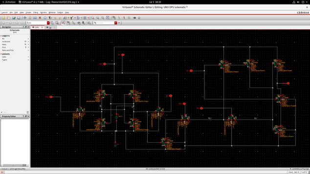

# SRAM-Based Digital Compute-in-Memory (FlexDCIM)

### 8-Bit SRAM Digital Compute-in-Memory Design & Analysis

  
  
  
  

**Circuit-level design and simulation of an SRAM-based digital compute-in-memory processing unit, with transient-state verification and hold/read/write static-noise-margin characterization across process corners and supply voltages.**

---

> **Scope note:** This repository documents the circuit implementation and analyses described in the project materials. The full 64 Kb FlexDCIM macro and its published performance figures belong to the referenced research paper; they are not claims of a full-chip implementation in this repository.

## Project at a glance

- **EDA flow:** Cadence Virtuoso, ADE-L / Visualization & Analysis XL, Spectre
- **Technology context:** TSMC 65 nm CMOS
- **Circuit focus:** SRAM storage cell combined with a digital compute logic slice
- **Verification:** Transient response for stored states Q = 0 and Q = 1
- **Stability:** Hold-, read-, and write-mode butterfly-curve SNM
- **Variation study:** TT, FF, SS, SF and FS process corners; 1.1 V, 1.2 V and 1.3 V supplies; 10–50 °C temperature sweep

## Why SRAM compute-in-memory?

In a conventional processor-memory system, moving data between memory and compute logic consumes time and energy. Compute-in-memory (CIM) places selected operations closer to stored data, reducing repeated data movement. Digital SRAM-CIM uses digital logic for computation and is designed to integrate with conventional CMOS logic flows.

This project examines a DPU-style cell from the FlexDCIM architecture and studies both compute-path behaviour and SRAM storage stability.

### Three compute-in-memory approaches

The supplied architecture figure contrasts an **all-digital** approach (SRAM plus a separate digital processing element), a **near-memory** approach (computation close to the SRAM array), and an **in-memory** approach (the array participates in computing with a mixed-signal readout). This is reference context for the design space, not a claim that all three architectures were implemented in this project.

### SRAM bit-cell and compute logic

The supplied bit-cell figure separates the **8T SRAM bit-cell** from the **digital logic** section and labels the internal storage, word-line, bit-line and enable/compute connections. It helps show how storage and compute circuitry are organized at the cell level.

The wider array-level diagram below illustrates SRAM blocks, bit-line driver/pre-charge, CIM/SRAM drivers, binary-adder trees and accumulators. It is included as architecture context from the supplied project material; its reported macro-level specifications should not be read as measurements from this repository's circuit simulations.

## Original circuit schematic

The image below shows the original Cadence Virtuoso schematic.

The schematic screenshot is the supplied Cadence Virtuoso DPU schematic.

The project material also includes a circuit-level transient screenshot pair for the stored states **Q = 0** and **Q = 1**.

| Signal | Role in the presented testbench |
|---|---|
| WL / BLB | Write/control the stored operand state |
| WS | Weight-select control |
| EN | Enables the digital compute path |
| RWL | Read/evaluation timing |
| Q / QB | Complementary SRAM storage nodes |
| CBL | Compute bit-line output |

## Methodology

### 1. Schematic implementation
The DPU-style SRAM cell and digital logic slice were captured in Cadence Virtuoso, following the reference architecture and device connections described in the project presentation.

### 2. Transient verification
Spectre transient analysis was run over a 0–100 ns interval. Input/control stimuli were applied to the word-line, weight-select, enable and read-word-line signals. The stored state and compute output were inspected for Q = 0 and Q = 1.

### 3. SRAM stability analysis
Butterfly curves were used to estimate static noise margin (SNM). The largest square that fits between the mirrored voltage-transfer curves provides the SNM measure.

- **Hold SNM:** word-line held low; evaluates data-retention stability.
- **Read SNM:** read condition with word-line asserted and bit-lines precharged; evaluates read-disturb robustness.
- **Write-mode SNM:** evaluates stability under the write/half-select condition used in the simulation setup.

### 4. PVT characterization
The presented sweeps cover five process corners (TT, FF, SS, SF, FS), three supply values (1.1 V, 1.2 V, 1.3 V) and five temperatures (10–50 °C). Each mode is assessed using the worst-case SNM reported for each corner/supply combination.

## Reported results

The PVT presentations provide worst-case SNM values across five process corners (TT, FF, SS, FS, SF) and supply voltages of 1.1 V, 1.2 V and 1.3 V. Each table summarizes the worst-case marker across the 10–50 °C temperature family.

### Hold-mode SNM (V)

| Corner | 1.1 V | 1.2 V | 1.3 V |
|---|---:|---:|---:|
| TT | 0.520 | 0.622 | 0.720 |
| FF | 0.529 | 0.629 | 0.729 |
| SS | 0.531 | 0.631 | 0.731 |
| FS | 0.589 | 0.688 | 0.788 |
| SF | 0.452 | 0.558 | 0.658 |

### Read-mode SNM (V)

| Corner | 1.1 V | 1.2 V | 1.3 V |
|---|---:|---:|---:|
| TT | 0.528 | 0.633 | 0.733 |
| FF | 0.546* | 0.646 | 0.746 |
| SS | 0.530 | 0.630 | 0.730 |
| FS | 0.608 | 0.709 | 0.810 |
| SF | 0.479 | 0.579 | 0.679 |

### Write-mode SNM (V)

| Corner | 1.1 V | 1.2 V | 1.3 V |
|---|---:|---:|---:|
| TT | 0.529 | 0.629 | 0.729 |
| FF | 0.539 | 0.639 | 0.739 |
| SS | 0.532 | 0.632 | 0.732 |
| FS | 0.601 | 0.701 | 0.801 |
| SF | 0.469 | 0.569 | 0.639 |

| Mode | Minimum SNM | Worst corner / supply | Maximum SNM | Best corner / supply |
|---|---:|---|---:|---|
| Hold | 0.452 V | SF / 1.1 V | 0.788 V | FS / 1.3 V |
| Read | 0.479 V | SF / 1.1 V | 0.810 V | FS / 1.3 V |
| Write | 0.469 V | SF / 1.1 V | 0.801 V | FS / 1.3 V |

*The READ presentation labels FF at 1.1 V as trend-interpolated and pending direct simulation. Keep it marked as an estimate until direct simulation is complete.

**Key observation:** SNM increases with supply voltage in all three datasets. SF (slow-NMOS / fast-PMOS) is the recurring worst-case corner; FS (fast-NMOS / slow-PMOS) is the recurring best-case corner.

See [full PVT tables and notes](docs/pvt-analysis.md) for the detailed methodology and caveats.

## Tools and why they are used

| Tool | Purpose in this project |
|---|---|
| **Cadence Virtuoso** | Schematic capture and circuit-level design |
| **Spectre** | Transient and DC simulation |
| **ADE-L / Visualization & Analysis XL** | Simulation setup, waveform inspection and curve analysis |
| **Python (supporting scripts only)** | Optional post-processing, tabulation and plotting of exported numerical results; not the circuit-design or simulation engine |
| **Git / GitHub** | Versioning and documentation |

## Repository structure

~~~text
.
├── assets/              # Repository artwork
├── data/                # Numerical input/result data
├── docs/                # Background, methodology and results
├── results/figures/     # Plots derived from documented data
├── schematics/          # Circuit schematic material
├── scripts/             # Supporting analysis and automation
├── testbenches/         # Testbench templates
└── tests/               # Automated checks for supporting scripts
~~~

## Scope and next steps

- Complete and document the full WS × Q truth-table sweep.
- Clearly separate measured simulation output from estimated or interpolated values.
- Add further high-resolution transient and SNM screenshots where the original simulation exports are available.
- If layout and extracted-view verification are completed, include the corresponding layout, DRC/LVS and post-layout evidence; otherwise list them as future work.

## References

1. V. Sharma, X. Zhang, N. S. Dhakad and T. T.-H. Kim, “FlexDCIM: A 400 MHz 249.1 TOPS/W 64 Kb Flexible Digital Compute-in-Memory SRAM Macro for CNN Acceleration,” *IEEE Transactions on Circuits and Systems I*, vol. 72, no. 10, 2025.
2. C.-J. Jhang et al., “Challenges and Trends of SRAM-Based Computing-In-Memory for AI Edge Devices,” *IEEE Transactions on Circuits and Systems I*, vol. 68, no. 5, 2021.

The referenced papers describe research architectures and published macro-level results. Those figures should not be presented as measurements from this project unless independently reproduced.

## Author

**Sahil Chhabra**  
B.Tech — VLSI Design & Technology
